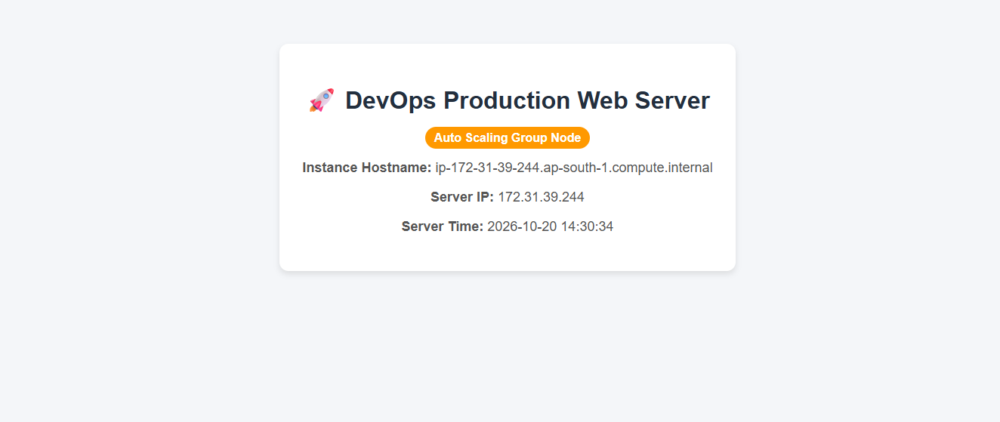
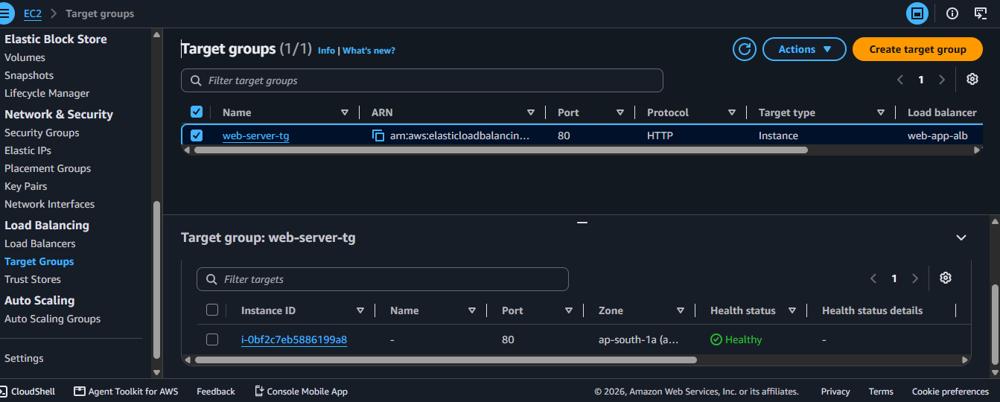
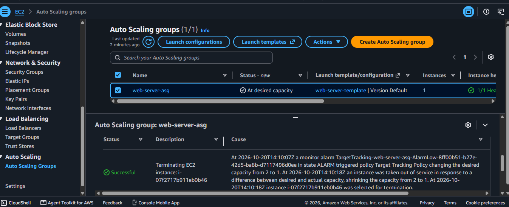

# 🚀 High-Availability & Hardened Web Infrastructure on AWS

A production-ready, fault-tolerant, and auto-scaling web application architecture deployed on AWS using core IaaS services while strictly adhering to a **₹0 Free-Tier budget**.

---

## 🏗️ Architecture Overview

The system design focuses on high availability, auto-scaling, load balancing, and network security across multiple Availability Zones (AZs).
---

## 🛠️ Tech Stack & AWS Services Used

* **AWS EC2:** Amazon Linux 2023 instances (`t2.micro` / `t3.micro`).
* **Application Load Balancer (ALB):** Distributes incoming web traffic seamlessly across multiple targets.
* **Auto Scaling Group (ASG):** Dynamically scales instance capacity between 1 to 3 instances based on 50% CPU metric threshold.
* **Launch Template:** Standardized configuration blueprint containing AMI, security configurations, and user data scripts.
* **Security Groups:** Fine-grained firewall rules limiting access strictly to HTTP (Port 80) and SSH (Port 22).
* **Apache & PHP:** Automated setup via User Data scripts to serve a dynamic System Health Monitoring page.

---

## 🚀 Deployment & Configuration Steps

### 1. Network & Security
* Provisioned `web-server-sg` Security Group allowing inbound HTTP (Port 80) and SSH (Port 22) traffic from `0.0.0.0/0`.

### 2. Automated Web Server Script (User Data)
* Utilized a bash bootstrap script in the Launch Template (`web-server-template`) to install Apache, PHP, and automatically deploy a dynamic System Dashboard displaying host information and runtime IP.

### 3. Load Balancing & Target Group Setup
* Configured target group `web-server-tg` using HTTP protocol on port 80 with `/index.php` health check path.
* Attached Target Group to internet-facing `web-app-alb` across multiple Availability Zones.

### 4. Auto-Scaling Group Configuration
* Integrated `web-server-asg` with the Launch Template and Target Group.
* Configured capacity defaults:
  * **Min Capacity:** 1
  * **Desired Capacity:** 2
  * **Max Capacity:** 3
* Applied a Target Tracking Scaling Policy anchored to 50% Average CPU Utilization.

---

## 🧪 Testing & Verification

1. **Load Balancing Verification:** Accessed the ALB public DNS endpoint (`http://web-app-alb-xxxxxxxx.ap-south-1.elb.amazonaws.com`).
2. **Traffic Distribution:** Refreshed the dashboard to verify that incoming HTTP requests were routed alternatively across multiple dynamic EC2 instances.
3. **Health Checks:** Validated target instance status transitions from `Initial` to `Healthy` state under Load Balancer Target Group monitoring.

---

## 🧹 Decommissioning & Cost Optimization

To maintain a **strict ₹0 budget profile**, all resources were safely decommissioned in the following sequence:
1. Deleted the Auto Scaling Group (`web-server-asg`) to automatically terminate linked EC2 instances.
2. Deleted the Application Load Balancer (`web-app-alb`) and Target Group (`web-server-tg`).
3. Removed the Launch Template (`web-server-template`) and Security Groups.
## 📸 Proof of Implementation

### 1. Application Load Balancer Live Dashboard

### 2. Target Group Health Check (Healthy Status)

### 3. Auto Scaling Group Activity Log

